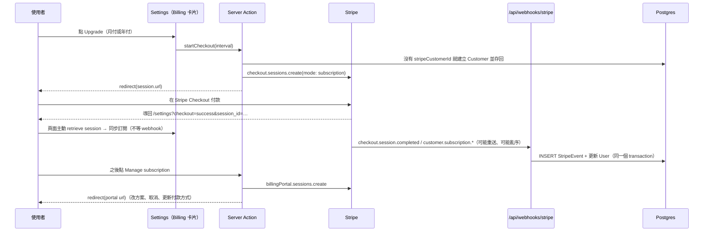

# Stripe 訂閱整合計畫

> DevStash Pro：$8／月、$72／年。依據：`context/research/stripe-integration-research.md`、`context/project-overview.md`（§3.3、§4.2、§6）、`prisma/schema.prisma`，以及現有程式碼（`src/lib/plan.ts`、`src/lib/current-user.ts`、`src/auth.ts`、`src/actions/`、`src/app/api/`）。
> Stripe 資訊查自官方文件與 `stripe` 套件 v23.0.0（2026-10-01 發佈，預設 API 版本 `2026-09-30.endive`）。
> 本文是實作計畫，尚未實作。

## 0. 先修正研究 prompt 的三個前提

研究 prompt 假設的資料模型和這個專案不同，照它做會出問題：

| prompt 的假設 | 實際狀況 | 影響 |
| --- | --- | --- |
| User 有 `isPro` 布林欄位 | **沒有**。存的是 `plan`（FREE／PRO）、`subscriptionStatus`（8 種，對應 Stripe 狀態）、`currentPeriodEnd`；`isPro` 由 `src/lib/plan.ts` 的 `isPro()` 即時推導（§3.3 刻意這樣設計：布林值裝不下「已取消但付到月底」、`past_due` 寬限期等狀態） | webhook 要同步的是這三個欄位，不是一個布林值 |
| User 有 `stripeSubscriptionId` | **沒有**，只有 `stripeCustomerId`（`@unique`） | 需要一個 migration 補上（見 §2.1） |
| 要在 JWT callback 每次查 DB 同步 `isPro` | **不需要**。`isPro` 從來沒放進 JWT：`getCurrentUser()`（`src/lib/current-user.ts`）每個請求都從資料庫重讀 `plan`／`subscriptionStatus`／`currentPeriodEnd` 再算 `isPro`，server action 用的 `getUserIsPro()` 也是直接查 DB | webhook 寫入資料庫後，**下一個請求就會生效**，不必改 `jwt` callback |

第三點特別重要：照 prompt 的做法在 `jwt` callback 加查詢，反而會讓 `/api/auth/session` 每次都多一次 DB 查詢，而且 `src/auth.ts` 的註解已經說明刻意不處理 `trigger === "update"`（避免被偷的舊 token 自行更新 `sessionVersion`）。**維持現狀即可。**

真正要處理的同步問題是另一個：使用者付款完成、從 Stripe 回到網站時，webhook 可能還沒到。做法見 §3.4：回到網站的頁面主動向 Stripe 查一次並同步，webhook 只是補強。

## 1. 現況分析

### 1.1 使用者與方案資料

```prisma
model User {
  plan               Plan                @default(FREE)
  stripeCustomerId   String?             @unique
  subscriptionStatus SubscriptionStatus?
  currentPeriodEnd   DateTime?
  // …
}

enum SubscriptionStatus { ACTIVE TRIALING PAST_DUE CANCELED UNPAID INCOMPLETE INCOMPLETE_EXPIRED PAUSED }

model StripeEvent {      // webhook 冪等表（§4.2），已存在但尚未使用
  id          String   @id   // = Stripe event.id
  type        String
  processedAt DateTime @default(now())
}
```

`isPro()`（`src/lib/plan.ts`）：`plan === "PRO"`、狀態是 `ACTIVE` 或 `TRIALING`、且 `currentPeriodEnd` 在未來。`PAST_DUE`（扣款失敗、Stripe 重試中）目前**不算** Pro，見 §6 第 2 題。

### 1.2 認證與 session

- Auth.js v5、JWT strategy。JWT 只帶 `sub`（User.id）與 `sessionVersion`
- `src/proxy.ts` 只驗 JWT 簽章，不碰方案；`/api/*` 不在 matcher 內，API route 自行驗證
- 頁面與 action 取得使用者：`getCurrentUser()`／`getCurrentUserId()`（`cache()`，同一個請求只查一次），比對 `sessionVersion`
- `CurrentUser.isPro` 已在 layout 使用（`canUploadFiles(user.isPro)` 決定新增 item 可選的型別）

### 1.3 既有的付款相關程式碼

- 沒有 `stripe` 套件、沒有 webhook route、沒有 checkout 流程
- `.env` 已經有 `STRIPE_SECRET_KEY`、`STRIPE_PUBLISHABLE_KEY`、`STRIPE_WEBHOOK_SECRET`、`STRIPE_PRICE_ID_MONTHLY`、`STRIPE_PRICE_ID_YEARLY` 五個鍵（只確認了鍵名）。本計畫沿用這些名稱
- 首頁 Pricing 的 Pro 按鈕目前連到 `/register`（未登入）或 `/dashboard`（已登入），`homepage-content.ts` 的 `getHomeLinks` 註明「接上 Stripe 後改成結帳頁」

## 2. 功能限制（Feature Gating）

### 2.1 額度與 Pro 功能的現況

判斷全部集中在 `src/lib/plan.ts`，呼叫點如下：

| 限制 | Free | 檢查位置 | 狀態 |
| --- | --- | --- | --- |
| 項目數 | 50（`FREE_ITEM_LIMIT`） | `createItem`（`src/actions/items.ts`，`createItemInDb` 在 transaction 內數）、`prepareUpload`（`src/lib/uploads.ts`） | ✅ 已執行 |
| collection 數 | 3（`FREE_COLLECTION_LIMIT`） | `createCollection`（`src/actions/collections.ts`，transaction 內數） | ✅ 已執行 |
| content 大小 | 100 KB（Pro 1 MB） | `checkContentSize`，新增與編輯都檢查 | ✅ 已執行 |
| 檔案／圖片上傳 | ✗ | `canUploadFiles`：`createItem`、`prepareUpload`（403 `pro-required`）、layout 的型別清單；側邊欄 Files／Images 有 PRO 標示（`ItemType.isProOnly`） | ⚠️ **開發期對所有人開放**：`FILE_UPLOADS_REQUIRE_PRO = false` |
| AI 功能 | ✗ | 尚未實作（建置順序第 10 步） | — |
| 資料匯出 | ✗ | 尚未實作（第 11 步） | — |
| 自訂型別 | ✗ | 延後實作 | — |

所以 Stripe 上線時，額度這一塊**幾乎不用改程式**：只要 webhook 正確寫入 `plan`／`subscriptionStatus`／`currentPeriodEnd`，`isPro()` 就會讓上述所有限制自動切換。唯一要動的是把 `FILE_UPLOADS_REQUIRE_PRO` 改成 `true`。

### 2.2 降級時的既有資料

Pro 到期變回 Free 後，超過 50 筆的 items、超過 3 個的 collections、已上傳的檔案**全部保留且可讀、可編輯、可刪除**，只是不能再新增（現有的額度檢查本來就只擋新增）。這是現有程式碼的自然行為，不需要額外處理，但應寫進 Pricing／Billing 的說明文字。

### 2.3 Settings 頁的結構

`src/app/(app)/settings/page.tsx`：`NARROW_PAGE_CLASS` 容器，兩個 `<section>`：Editor（偏好設定卡片）與 Account（變更密碼、刪除帳號）。Billing 卡片放在 Account 之前，新增一個 `<section id="billing">`。

## 3. 架構

### 3.1 流程



### 3.2 設計原則

1. **Stripe 是唯一真相。** webhook 收到事件後，不直接採用事件 payload 裡的 subscription，而是再 `subscriptions.retrieve()` 取最新狀態。Stripe 不保證事件順序，舊事件晚到時若直接採用 payload，會把新狀態蓋回舊的
2. **同步只有一個入口。** 回到網站時的主動同步、webhook、帳號刪除前的處理，都呼叫同一個 `syncSubscription()`
3. **冪等。** `StripeEvent` 以 `event.id` 為主鍵，和使用者欄位的更新放在同一個 transaction；主鍵衝突代表處理過，直接回 200。處理失敗則整個 rollback，Stripe 重送時會再處理一次
4. **結帳、管理訂閱用 server action**（coding standards：表單提交與簡單的變更用 server action）；**webhook 用 API route**（需要原始 body 與 HTTP 狀態碼）
5. **純邏輯放 `src/lib/`、可單元測試**：Stripe 狀態對應、subscription → User 欄位、事件分派

### 3.3 方案判斷不變

`isPro()` 的判斷不改。webhook 寫入的欄位規則：

| Stripe subscription | `plan` | `subscriptionStatus` | `currentPeriodEnd` |
| --- | --- | --- | --- |
| `active`／`trialing`（含已排定在期末取消） | PRO | ACTIVE／TRIALING | `items.data[0].current_period_end` |
| `past_due`／`unpaid`／`incomplete`／`paused` | PRO | 對應的 enum | 同上 |
| `canceled`／`incomplete_expired`，或 `customer.subscription.deleted` | FREE | CANCELED／INCOMPLETE_EXPIRED | 保留最後的值 |

注意：從 API 版本 `2025-03-31.basil` 起，`current_period_end` 從 Subscription 移到了 **subscription item** 上（`subscription.items.data[i].current_period_end`）。DevStash 每個 subscription 只有一個 price，取 `items.data[0]` 即可；不要讀 `subscription.current_period_end`。

「已取消但付到期末」不需要特別處理：Stripe 在期末前狀態仍是 `active`（另有 `cancel_at`），期末才變 `canceled` 並發 `customer.subscription.deleted`。`isPro()` 也會在 `currentPeriodEnd` 過了之後自動失效，即使 webhook 漏了也不會無限期保持 Pro。

### 3.4 付款完成後的同步（取代 prompt 的 JWT 做法）

`success_url` 帶 `{CHECKOUT_SESSION_ID}`。Settings 頁收到 `checkout=success&session_id=…` 時：

1. `checkout.sessions.retrieve(sessionId, { expand: ["subscription"] })`
2. 確認 `session.client_reference_id === 目前使用者的 id`（避免拿別人的 session id 來同步）
3. 呼叫 `syncSubscription()` 寫入資料庫，再照常渲染

這樣使用者一回到網站就看到 Pro，不必等 webhook 或重新整理。webhook 晚到時，因為內容相同，再寫一次也無妨。

## 4. 要新增的檔案

### 4.1 Migration：補上訂閱欄位

`prisma/schema.prisma` 的 `User`：

```prisma
  plan                 Plan                @default(FREE)
  stripeCustomerId     String?             @unique
  /// 目前的訂閱；webhook 以它對應回使用者，帳號刪除時用來取消訂閱
  stripeSubscriptionId String?             @unique
  /// 目前訂閱的 price，Billing 卡片據此顯示月付或年付
  stripePriceId        String?
  subscriptionStatus   SubscriptionStatus?
  currentPeriodEnd     DateTime?
  /// 已排定在期末取消（Stripe 的 cancel_at 有值）；Billing 卡片顯示「將於 X 取消」
  cancelAtPeriodEnd    Boolean             @default(false)
```

依 CLAUDE.md：在 **Development** 分支執行 `prisma migrate dev --name stripe-subscription`；production 由部署流程的 `prisma migrate deploy` 套用。

### 4.2 `src/lib/stripe.ts`：Stripe client 與 price 設定

```ts
import Stripe from "stripe";

/**
 * 延遲建立：build 時沒有 STRIPE_SECRET_KEY 也能 import 這個檔案。
 * 明確指定 apiVersion：套件升級不會悄悄改變 API 回應的形狀，型別也只對應最新版
 */
let client: Stripe | null = null;

export function getStripe(): Stripe {
  if (!client) {
    const key = process.env.STRIPE_SECRET_KEY;
    if (!key) {
      throw new Error("STRIPE_SECRET_KEY is not set");
    }
    client = new Stripe(key, { apiVersion: "2026-09-30.endive" });
  }
  return client;
}

export type BillingInterval = "monthly" | "yearly";

/** price id 來自環境變數：test 與 live 模式的 id 不同 */
export function getPriceId(interval: BillingInterval): string {
  const id =
    interval === "monthly"
      ? process.env.STRIPE_PRICE_ID_MONTHLY
      : process.env.STRIPE_PRICE_ID_YEARLY;
  if (!id) {
    throw new Error(`Stripe price for ${interval} is not set`);
  }
  return id;
}

/** price id 反查計費週期；不是這兩個 price 時回傳 null（例如舊方案） */
export function getIntervalForPrice(priceId: string | null): BillingInterval | null {
  if (priceId && priceId === process.env.STRIPE_PRICE_ID_MONTHLY) return "monthly";
  if (priceId && priceId === process.env.STRIPE_PRICE_ID_YEARLY) return "yearly";
  return null;
}
```

`STRIPE_PUBLISHABLE_KEY` 在這個做法裡用不到：hosted Checkout 與 Customer Portal 都是導向 Stripe 的頁面，前端不需要 Stripe.js。可以保留給日後的嵌入式付款。

### 4.3 `src/lib/billing.ts`：純函式（單元測試重點）

```ts
import type Stripe from "stripe";

import type { Plan, SubscriptionStatus } from "@/generated/prisma/enums";

const STATUS: Record<Stripe.Subscription.Status, SubscriptionStatus> = {
  active: "ACTIVE",
  trialing: "TRIALING",
  past_due: "PAST_DUE",
  canceled: "CANCELED",
  unpaid: "UNPAID",
  incomplete: "INCOMPLETE",
  incomplete_expired: "INCOMPLETE_EXPIRED",
  paused: "PAUSED",
};

const ENDED: SubscriptionStatus[] = ["CANCELED", "INCOMPLETE_EXPIRED"];

export interface SubscriptionFields {
  plan: Plan;
  stripeSubscriptionId: string;
  stripePriceId: string | null;
  subscriptionStatus: SubscriptionStatus;
  currentPeriodEnd: Date | null;
  cancelAtPeriodEnd: boolean;
}

/**
 * Stripe subscription → User 欄位，規則見計畫 §3.3。
 * current_period_end 在 subscription item 上（API 2025-03-31.basil 起），
 * DevStash 每個 subscription 只有一個 price，取第一個 item
 */
export function toSubscriptionFields(
  subscription: Stripe.Subscription,
): SubscriptionFields {
  const status = STATUS[subscription.status];
  const item = subscription.items.data[0];
  return {
    plan: ENDED.includes(status) ? "FREE" : "PRO",
    stripeSubscriptionId: subscription.id,
    stripePriceId: item?.price.id ?? null,
    subscriptionStatus: status,
    currentPeriodEnd: item ? new Date(item.current_period_end * 1000) : null,
    cancelAtPeriodEnd: subscription.cancel_at !== null,
  };
}

/** Stripe 的 customer／subscription 欄位可能是 id 字串或已 expand 的物件 */
export function stripeId(value: string | { id: string } | null): string | null {
  if (value === null) return null;
  return typeof value === "string" ? value : value.id;
}
```

### 4.4 `src/lib/db/billing.ts`：資料庫寫入

```ts
import { Prisma } from "@/generated/prisma/client";
import type { SubscriptionFields } from "@/lib/billing";
import { prisma } from "@/lib/prisma";

/** 依 Stripe customer 找使用者；webhook 只拿得到 customer id */
export function findUserIdByCustomer(customerId: string) {
  return prisma.user
    .findUnique({ where: { stripeCustomerId: customerId }, select: { id: true } })
    .then((user) => user?.id ?? null);
}

/**
 * 只在還沒有 customer 時寫入，避免兩次同時點 Upgrade 各建一個 customer 並互相覆蓋。
 * 回傳 false 代表別的請求先寫入了，呼叫端改用資料庫裡的值
 */
export async function saveCustomerId(userId: string, customerId: string) {
  const result = await prisma.user.updateMany({
    where: { id: userId, stripeCustomerId: null },
    data: { stripeCustomerId: customerId },
  });
  return result.count === 1;
}

/** 回到網站時的主動同步與帳號刪除用：不經 StripeEvent */
export function saveSubscription(userId: string, fields: SubscriptionFields) {
  return prisma.user.update({ where: { id: userId }, data: fields });
}

/**
 * webhook 用：事件紀錄與使用者更新在同一個 transaction。
 * 主鍵衝突（P2002）代表這個事件處理過，回傳 "duplicate"
 */
export async function applyStripeEvent(
  event: { id: string; type: string },
  userId: string | null,
  fields: SubscriptionFields | null,
): Promise<"applied" | "duplicate"> {
  try {
    await prisma.$transaction(async (tx) => {
      await tx.stripeEvent.create({ data: { id: event.id, type: event.type } });
      if (userId && fields) {
        await tx.user.update({ where: { id: userId }, data: fields });
      }
    });
    return "applied";
  } catch (error) {
    if (
      error instanceof Prisma.PrismaClientKnownRequestError &&
      error.code === "P2002"
    ) {
      return "duplicate";
    }
    throw error;
  }
}
```

### 4.5 `src/lib/billing-sync.ts`：Stripe → 資料庫的唯一入口

```ts
import type Stripe from "stripe";

import { stripeId, toSubscriptionFields } from "@/lib/billing";
import { applyStripeEvent, findUserIdByCustomer, saveSubscription } from "@/lib/db/billing";
import { getStripe } from "@/lib/stripe";

/** 處理的事件；其他事件只記錄、不更新使用者 */
export const HANDLED_EVENTS = new Set<Stripe.Event.Type>([
  "checkout.session.completed",
  "customer.subscription.created",
  "customer.subscription.updated",
  "customer.subscription.deleted",
  "invoice.payment_failed",
]);

/** 事件裡的 subscription id；不是訂閱相關的事件回傳 null */
function subscriptionIdOf(event: Stripe.Event): string | null {
  const object = event.data.object;
  switch (event.type) {
    case "checkout.session.completed":
      return stripeId((object as Stripe.Checkout.Session).subscription);
    case "customer.subscription.created":
    case "customer.subscription.updated":
    case "customer.subscription.deleted":
      return (object as Stripe.Subscription).id;
    case "invoice.payment_failed":
      return stripeId(
        (object as Stripe.Invoice).parent?.subscription_details?.subscription ?? null,
      );
    default:
      return null;
  }
}

/**
 * webhook 的主要邏輯（route 只負責驗簽與 HTTP）。不採用 payload 裡的 subscription，
 * 而是重新 retrieve：Stripe 不保證事件順序，晚到的舊事件不能蓋掉新狀態
 */
export async function handleStripeEvent(event: Stripe.Event) {
  const subscriptionId = HANDLED_EVENTS.has(event.type) ? subscriptionIdOf(event) : null;
  if (!subscriptionId) {
    return applyStripeEvent(event, null, null);
  }

  const subscription = await getStripe().subscriptions.retrieve(subscriptionId);
  const customerId = stripeId(subscription.customer);
  const userId = customerId ? await findUserIdByCustomer(customerId) : null;
  // 找不到使用者（帳號已刪除，或 customer 不是由 DevStash 建立）：只記錄事件
  return applyStripeEvent(event, userId, userId ? toSubscriptionFields(subscription) : null);
}

/** 付款完成導回網站時呼叫；session 必須屬於這個使用者 */
export async function syncCheckoutSession(userId: string, sessionId: string) {
  const session = await getStripe().checkout.sessions.retrieve(sessionId, {
    expand: ["subscription"],
  });
  if (session.client_reference_id !== userId || !session.subscription) {
    return false;
  }
  const subscription = session.subscription as Stripe.Subscription;
  await saveSubscription(userId, toSubscriptionFields(subscription));
  return true;
}
```

`invoice.payment_failed` 的 subscription id 位置隨 API 版本改過（新版在 `invoice.parent.subscription_details.subscription`）。實作時以安裝的 `stripe` 型別為準；這個事件其實也會伴隨 `customer.subscription.updated`（狀態變 `past_due`），只處理後者也可以。

### 4.6 `src/actions/billing.ts`：結帳與管理訂閱

```ts
"use server";

import { redirect } from "next/navigation";
import { z } from "zod";

import { GENERIC_ERROR_MESSAGE, NOT_SIGNED_IN_MESSAGE } from "@/lib/action-errors";
import { getCurrentUser } from "@/lib/current-user";
import { getBillingCustomer, saveCustomerId } from "@/lib/db/billing";
import { checkRateLimit, rateLimitMessage } from "@/lib/rate-limit";
import { getPriceId, getStripe } from "@/lib/stripe";
import { getAppUrl } from "@/lib/tokens";

const intervalSchema = z.enum(["monthly", "yearly"]);

export interface BillingResult {
  success: boolean;
  error?: string;
}

/**
 * 導向 Stripe Checkout。順序：驗證 → 登入 → 速率限制 → 已是 Pro 就改去 portal →
 * 取得或建立 customer → 建立 session → redirect（放在 try 之外，redirect 以例外結束）
 */
export async function startCheckout(interval: unknown): Promise<BillingResult> {
  const parsed = intervalSchema.safeParse(interval);
  if (!parsed.success) {
    return { success: false, error: "Choose a billing interval" };
  }

  let url: string;
  try {
    const user = await getCurrentUser();
    if (!user) {
      return { success: false, error: NOT_SIGNED_IN_MESSAGE };
    }
    const limit = await checkRateLimit("billing", user.id);
    if (!limit.success) {
      return { success: false, error: rateLimitMessage(limit.reset) };
    }
    if (user.isPro) {
      // 已訂閱的人改方案走 portal，不能再建第二個 subscription
      return openBillingPortal();
    }

    const customerId = await ensureCustomer(user.id, user.email);
    const session = await getStripe().checkout.sessions.create({
      mode: "subscription",
      customer: customerId,
      client_reference_id: user.id,
      line_items: [{ price: getPriceId(parsed.data), quantity: 1 }],
      success_url: `${getAppUrl()}/settings?checkout=success&session_id={CHECKOUT_SESSION_ID}#billing`,
      cancel_url: `${getAppUrl()}/settings?checkout=canceled#billing`,
      allow_promotion_codes: true,
    });
    if (!session.url) {
      return { success: false, error: GENERIC_ERROR_MESSAGE };
    }
    url = session.url;
  } catch (error) {
    console.error("Failed to start checkout", error);
    return { success: false, error: GENERIC_ERROR_MESSAGE };
  }
  redirect(url);
}

/** 導向 Stripe Customer Portal：改月付／年付、取消、更新付款方式、看發票 */
export async function openBillingPortal(): Promise<BillingResult> { /* 同樣的結構：
  登入 → 速率限制 → 沒有 stripeCustomerId 回錯誤 →
  billingPortal.sessions.create({ customer, return_url: `${getAppUrl()}/settings#billing` }) → redirect */ }

/** 沒有 customer 就建立；metadata 帶 userId，方便在 Dashboard 對照 */
async function ensureCustomer(userId: string, email: string): Promise<string> {
  const existing = await getBillingCustomer(userId);
  if (existing) return existing;
  const customer = await getStripe().customers.create(
    { email, metadata: { userId } },
    // 同一個使用者 24 小時內重複建立只會回同一個 customer
    { idempotencyKey: `customer-${userId}` },
  );
  if (await saveCustomerId(userId, customer.id)) return customer.id;
  return (await getBillingCustomer(userId))!;
}
```

要配合新增：`src/lib/db/billing.ts` 的 `getBillingCustomer(userId)`（只讀 `stripeCustomerId`），以及 `src/lib/rate-limit.ts` 的 `billing: { tokens: 10, window: "1 m" }`。

### 4.7 `src/app/api/webhooks/stripe/route.ts`

```ts
import type Stripe from "stripe";

import { apiError } from "@/lib/api-response";
import { handleStripeEvent } from "@/lib/billing-sync";
import { getStripe } from "@/lib/stripe";

/**
 * Stripe webhook。驗簽需要原始 body，所以用 request.text()，不能先 JSON.parse。
 * 回 2xx 代表已處理；拋錯回 500，Stripe 會依退避策略重送（最多約 3 天），
 * StripeEvent 與使用者更新在同一個 transaction，失敗時不會留下「已處理」的紀錄。
 * proxy 不涵蓋 /api，這個 route 也不需要登入：身分來自簽章
 */
export async function POST(request: Request) {
  const signature = request.headers.get("stripe-signature");
  const secret = process.env.STRIPE_WEBHOOK_SECRET;
  if (!signature || !secret) {
    return apiError("Missing signature", 400);
  }

  let event: Stripe.Event;
  try {
    event = getStripe().webhooks.constructEvent(await request.text(), signature, secret);
  } catch {
    return apiError("Invalid signature", 400);
  }

  try {
    const result = await handleStripeEvent(event);
    return Response.json({ received: true, duplicate: result === "duplicate" });
  } catch (error) {
    console.error("Failed to handle Stripe event", event.id, event.type, error);
    return apiError("Webhook handler failed", 500);
  }
}
```

v23 的 `constructEvent` 預設會檢查時間戳（300 秒容許值），可防重放攻擊，不要傳 `tolerance: 0`。webhook 路徑不需要速率限制：未通過驗簽的請求在第一步就回 400。

### 4.8 `src/components/settings/BillingCard.tsx`

server component，由 Settings 頁傳入 `BillingSummary`（新增 `getBillingSummary(userId)`，回傳 `isPro`、`interval`、`currentPeriodEnd`、`cancelAtPeriodEnd`、`subscriptionStatus`、是否有 customer）。按鈕用 `<form action={…}>` 呼叫 action（client 小元件 `BillingButtons` 處理 pending 狀態與錯誤 toast）。

| 狀態 | 顯示 |
| --- | --- |
| Free | 目前方案 Free、用量（items x/50、collections x/3）、「Upgrade — $8/month」「$72/year（省 25%）」兩顆按鈕 |
| Pro、ACTIVE | Pro（月付／年付）、「Renews on {date}」、Manage subscription |
| Pro、已排定取消 | 「Cancels on {date}，之後回到 Free；資料都會保留」、Manage subscription（可恢復） |
| PAST_DUE／UNPAID | 警示：「Payment failed — update your payment method」、Manage subscription |
| 剛從 Checkout 回來（`checkout=success`） | 頂端成功訊息；`checkout=canceled` 時顯示「Checkout canceled」 |

## 5. 要修改的檔案

| 檔案 | 修改 |
| --- | --- |
| `prisma/schema.prisma` | §4.1 的三個欄位 + migration |
| `package.json` | `npm install stripe@23.0.0`（固定版本） |
| `src/lib/plan.ts` | `FILE_UPLOADS_REQUIRE_PRO` 改為 `true`（上線那一刻再改；改了之後側邊欄的 PRO 標示才名副其實） |
| `src/lib/current-user.ts`／`src/types/user.ts` | 不需改：`isPro` 已每個請求從 DB 推導 |
| `src/auth.ts`、`src/auth.config.ts` | **不改**（見 §0） |
| `src/app/(app)/settings/page.tsx` | 讀 `searchParams` 的 `checkout`／`session_id`；`checkout=success` 時先 `syncCheckoutSession(userId, sessionId)` 再查 `getBillingSummary`；在 Account 之前加 `<section id="billing">` 放 `BillingCard` |
| `src/lib/rate-limit.ts` | 新增 `billing` 限制 |
| `src/actions/profile.ts`（刪除帳號） | **刪除使用者前先取消訂閱**：有 `stripeSubscriptionId` 且狀態未結束時呼叫 `subscriptions.cancel(id)`；Stripe 呼叫失敗就中止刪除並回錯誤。否則使用者刪了帳號還會繼續被扣款 |
| `scripts/prune-users.ts` | 同上，或在預演輸出中列出仍有有效訂閱的帳號並略過 |
| `src/components/homepage/homepage-content.ts` | 已登入時 `planHref` 改為 `/settings#billing`；未登入維持 `/register` |
| 額度錯誤的提示（`itemLimitMessage`、`collectionLimitMessage` 的呼叫端） | toast 加上「Upgrade」動作連到 `/settings#billing`（sonner 的 `action`）；訊息文字已經提到 upgrade |
| `src/components/dashboard/UserMenu.tsx`（選用） | Pro 使用者在名稱旁顯示 PRO 標示 |
| `context/project-overview.md` | §3.3 補上新欄位的理由（文件規定改資料結構時同步更新） |
| `.env.production`、Vercel 環境變數 | 加入五個 STRIPE_* 鍵；`.env.local` 與 `.env.production` 的鍵名要一致（cleanup skill 第 7 項會比對） |

## 6. 實作前要決定的事

1. **Customer Portal 允許改方案嗎？** 建議允許在月付與年付之間切換（Stripe 自動按比例計費），取消設為「期末取消」
2. **`PAST_DUE` 算不算 Pro？** 目前 `isPro()` 不算，扣款一失敗就立刻失去 Pro 功能。Stripe 會重試約 2–3 週，多數 SaaS 在重試期間保留權限。建議把 `PAST_DUE` 加進 `isPro()` 的允許清單，最後一次重試失敗時 Stripe 會把狀態改成 `canceled` 或 `unpaid`
3. **要不要試用期？** 規格沒有提。若要，在 `checkout.sessions.create` 加 `subscription_data: { trial_period_days: 7 }`，`TRIALING` 已經算 Pro
4. **開發期的「所有人都是 Pro」策略**（§6「開發期策略」）：目前只對檔案上傳實作了這個開關，額度限制早已對 Free 生效。上線時只需改 `FILE_UPLOADS_REQUIRE_PRO`
5. **Preview 部署用哪組金鑰？** 建議 Preview 一律用 test mode 金鑰與 test 的 price id；只有 Production 用 live。這也呼應 feature-history 的待辦：Preview 與 Production 最好不要共用資料庫

## 7. Stripe Dashboard 設定步驟

先在 **test mode** 完成並驗證，再到 live mode 重做一次（product、price、webhook、portal 設定在兩個模式是分開的）。

1. **Product**：Product catalog → Add product → 名稱 `DevStash Pro`
2. **Prices**（同一個 product 下兩個 recurring price）：
   - $8.00 USD／month，lookup key `pro_monthly`
   - $72.00 USD／year，lookup key `pro_yearly`
   - 把兩個 price id 填入 `STRIPE_PRICE_ID_MONTHLY`、`STRIPE_PRICE_ID_YEARLY`
3. **API keys**：Developers → API keys → Secret key 填入 `STRIPE_SECRET_KEY`（也可建立只開必要權限的 restricted key：Customers、Checkout Sessions、Subscriptions、Customer portal 的寫入權限）
4. **Customer portal**：Settings → Billing → Customer portal
   - 開啟：更新付款方式、查看發票、取消訂閱（期末取消）
   - 開啟切換方案，商品只放 DevStash Pro 的兩個 price
   - 預設回傳網址設成 `https://<網域>/settings#billing`
5. **Webhook**：Developers → Webhooks → Add endpoint
   - URL：`https://<production 網域>/api/webhooks/stripe`
   - 事件：`checkout.session.completed`、`customer.subscription.created`、`customer.subscription.updated`、`customer.subscription.deleted`、`invoice.payment_failed`
   - API 版本選 `2026-09-30.endive`（與程式碼裡的 `apiVersion` 一致）
   - 把 signing secret 填入 Production 的 `STRIPE_WEBHOOK_SECRET`
6. **本機開發**：用 Stripe CLI 轉送 webhook，CLI 會印出專用的 signing secret，填入 `.env.local` 的 `STRIPE_WEBHOOK_SECRET`
   ```bash
   stripe login
   stripe listen --forward-to localhost:3000/api/webhooks/stripe
   ```
7. **Branding**：Settings → Branding，設定 Checkout 與 portal 的名稱、顏色、圖示（深色主題用 `#6366f1` 當強調色，與首頁一致）

## 8. 測試清單

### 單元測試（Vitest，依 coding standards 只測 `src/lib/` 與 `src/actions/`）

- `src/lib/billing.test.ts`：`toSubscriptionFields` 對 8 種 Stripe 狀態的 `plan`／`subscriptionStatus`；`current_period_end` 取自 item；`cancel_at` 有值時 `cancelAtPeriodEnd`；`stripeId` 處理字串、物件與 null
- `src/lib/billing-sync.test.ts`（mock `@/lib/stripe` 與 `@/lib/db/billing`）：每種處理的事件都會 retrieve 最新的 subscription；未處理的事件只記錄；找不到使用者只記錄；`syncCheckoutSession` 拒絕別人的 session
- `src/lib/db/billing.test.ts`（mock `@/lib/prisma`）：`applyStripeEvent` 遇到 P2002 回 `"duplicate"`、其他錯誤往外拋；`saveCustomerId` 只在 `stripeCustomerId` 為 null 時寫入
- `src/actions/billing.test.ts`：interval 驗證、未登入、速率限制、已是 Pro 改走 portal、沒有 customer 時建立、Stripe 錯誤回通用訊息、成功時 `redirect` 到 session url（mock `next/navigation`）
- `src/lib/plan.test.ts`：若採用 §6 第 2 題，補 `PAST_DUE` 的案例

### 手動測試（test mode + Stripe CLI）

| 情境 | 做法 | 預期 |
| --- | --- | --- |
| 月付訂閱 | 卡號 `4242 4242 4242 4242` | 回到 Settings 立即顯示 Pro（月付）；檔案上傳可用；50／3 的限制解除 |
| 年付訂閱 | 同上，選年付 | Pro（年付），續約日一年後 |
| 需要 3D Secure | `4000 0025 0000 3155` | 驗證後成功；驗證失敗時維持 Free |
| 扣款被拒 | `4000 0000 0000 0002` | Checkout 顯示錯誤，維持 Free |
| 續約扣款失敗 | `4000 0000 0000 0341`（可綁定但扣款失敗）＋ test clock 推進到續約日 | 狀態 `PAST_DUE`，Billing 顯示警示（Pro 與否依 §6 第 2 題） |
| 期末取消 | Portal 取消 | 顯示「Cancels on…」且仍是 Pro；用 test clock 推進到期末後變回 Free，資料都還在 |
| 恢復訂閱 | 期末前在 Portal 取消「取消」 | `cancelAtPeriodEnd` 變回 false |
| 改方案 | Portal 月付改年付 | `stripePriceId` 更新，Billing 顯示年付 |
| webhook 重送 | `stripe events resend <evt_id>` | 回 200 且 `duplicate: true`，資料不變 |
| 簽章錯誤 | 直接 `curl` POST 到 webhook | 400 |
| webhook 比使用者早／晚到 | 暫停 `stripe listen` 後付款，再恢復 | 不論先後，最後狀態一致 |
| 刪除帳號 | Pro 使用者刪除帳號 | Stripe 上的 subscription 被取消，不再扣款 |
| 重複點 Upgrade | 快速點兩次 | 只建立一個 customer |
| 已是 Pro 再點 Upgrade | 呼叫 `startCheckout` | 導向 portal，不會有第二個 subscription |

### 上線前

- [ ] live mode 重做 §7 的 1–5 步，Production 環境變數換成 live 金鑰與 price id
- [ ] Production webhook 端點顯示成功送達（Dashboard → Webhooks → 事件紀錄）
- [ ] 用真卡訂閱一次再立刻在 portal 取消並退款
- [ ] `FILE_UPLOADS_REQUIRE_PRO = true` 已部署
- [ ] `npm test`、`npm run build` 通過；`prisma migrate status` 同步

## 9. 實作順序

建議拆成三個 feature，每個都能單獨合併、驗證：

1. **基礎（不影響使用者）**
   1. `npm install stripe@23.0.0`
   2. migration：§4.1 的三個欄位（Development 分支）
   3. `src/lib/stripe.ts`、`src/lib/billing.ts`（含單元測試）
   4. `src/lib/db/billing.ts`、`src/lib/billing-sync.ts`（含單元測試）
   5. webhook route；用 `stripe listen` + `stripe trigger customer.subscription.created` 驗證事件會寫入 `StripeEvent`
2. **結帳與管理**
   1. `src/actions/billing.ts`（含單元測試）與 rate limit
   2. Settings 的 Billing 卡片與 `checkout=success` 的主動同步
   3. 首頁 Pricing 已登入時連到 `/settings#billing`；額度錯誤 toast 加 Upgrade 動作
   4. 依 §8 的手動測試表在 test mode 走一輪
3. **上線**
   1. 刪除帳號前取消訂閱（`src/actions/profile.ts`、`scripts/prune-users.ts`）
   2. `FILE_UPLOADS_REQUIRE_PRO = true`
   3. 更新 `context/project-overview.md` §3.3
   4. live mode 設定與 Production 環境變數，依「上線前」清單驗證

AI 功能（第 10 步）實作時沿用同一個 `isPro` 判斷，並加上 `AiUsage` 的每日上限；資料匯出（第 11 步）同理，不需要再碰 Stripe。
